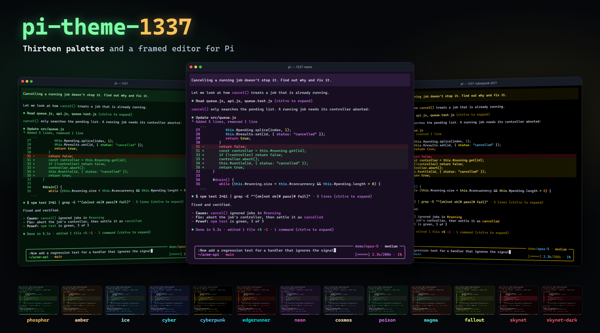

# pi-theme-1337



**Thirteen dark palettes and a framed terminal editor for [Pi](https://github.com/earendil-works/pi-mono).**
The pi-theme-1337 package combines diverse CRT, cyberpunk, synthwave, and HUD-inspired palettes with an extension that moves the editor and useful session status into a centered frame.

## What it adds

- A centered, rounded editor with a prompt marker and activity spinner, the model and thinking level in its top border (`openai/gpt-6.1-sol · xhigh`), and a status row: workspace, branch and session on the left; context usage against its window, estimated cost, the current run's spend and the persona on the right (`[▰▱▱▱▱] 136.9k/1M · 13% · ~$48.89 +$1.24 · 💻 Dev`).
- A status row that names a long-running tool (`Running npm test…`) in the workspace segment's place, without reflowing the rest of the row. When no tool is named, a run that has lasted three seconds shows its clock there instead: `Working… 45s`.
- A row that narrows by meaning: decorations go first, then path detail, and the context percentage stays visible to the end. The left group gives up whole details — the session name, then the branch, then the path down to its last folder — so a branch is shown whole or not at all, never as `fe…`.
- Subscription quota in the status row, between the cost and the persona, when the provider reports it: `5h 43% · wk 12%` (percent used of the five-hour and weekly windows), `wk 85%` for one window, or `limit` once the usage limit is reached. It turns to the warning color above 70% and the error color above 90%, and a figure above 70% stays visible while the rest of the row narrows. It comes only from what the provider already sends with each response — the package makes no request of its own — so it appears after the first response and shows nothing for providers that report nothing. Seen on live accounts: Anthropic's subscription headers (the weekly window) and OpenAI's usage-limit error on a ChatGPT login. Read from the published Codex client format but not yet seen live: the Codex headers and stream event, and Anthropic's five-hour window. `PI_1337_QUOTA=off` turns it off.
- A prompt marker that follows Pi's bash mode: `$` for `!command`, and a dim `$` for `!!command`, whose output stays out of the model's context.
- An end-of-run summary row in the transcript: `● Done in 2m 14s · edited 3 files +42 −7 · wrote 1 file · 6 commands, 1 failed · ~$1.24`. Expand tools (ctrl+o) to list each file and see where the time went (`model 1m 32s (40s thinking) · tools 42s · 48 tok/s`; thinking is part of the model time, and `tools` is everything that was not waiting on the model). A run that is retried or continued counts as one run. When pi-persona still has background work running, the row reads `● Turn ended in 9.0s · 7 tool calls · ~$0.08 · waiting on 3 agents, 1 timer` instead of `Done`. It is stored as a custom session entry that never reaches the model; changes made by shell commands are not counted.
- A terminal title that shows the run state (`● Running npm test… — repo`, `? Waiting for you`, `✓ Done`) and Pi's own title at rest. After a clean run it reads `◌ Waiting on 3 agents` until pi-persona's background work ends.
- Thirteen Pi themes that you can choose in `/settings`; Pi keeps the selected bundled theme across restarts. All thirteen are dark: when Pi is on a light theme the package keeps it and applies only the framed editor, status row and tool rows. Set `PI_1337_THEME=<palette>` (or `on` for the default green) to force a palette anyway.
- Compact tool transcript rows and theme-aware edit previews, with errors visible while collapsed. Quiet rows end with what they found (`· 6 matches`, `· no matches`, `· 40 lines`) and running or failed commands show their newest lines. A running command also names the timeout it was given (`● $ npm test (timeout 30s)`). Runs of settled reads and searches fold into one tally row — `● Read width.ts, frame.ts · searched 2 patterns`, or `● Read 12 files` when the names do not fit — until you click it or press the expand key.
- Rows from other extensions' tool renderers in the same flat frame: one status dot before the call, the result under `└`, no background box. Their lines are the renderer's own, unchanged; `/theme-1337` off returns them to Pi's box.
- A reversible `/theme-1337` toggle and a clean-buffer copy shortcut (`alt+c` by default). Toggling off gives the editor back to an extension that had installed its own before, and leaves alone one installed since. If another extension installs its editor over the frame while the redesign is on, Pi's own footer and working row come back until the next `/theme-1337` or session start, so the workspace, model, context, cost and spinner never go missing.

The extension changes presentation only. It leaves Pi's editor behavior, tool execution and prompts in place, and third-party custom tool renderers keep their content: only the frame around their lines changes.
When pi-persona is installed, the frame shows its persona and includes its child agents' spend in the cost, and the summary row and terminal title say when its background work is still running; the two packages work independently, and the frame is complete without it.

Edit previews use Pi's recorded diff, with separate changed spans emphasized inside
paired replacement lines. Collapsed previews show up to 16 rows; expand for the full
diff. Uneven change groups and large lines keep line colors without span emphasis.
Write previews show submitted file content.

Folding covers three or more consecutive `read`, `grep`, `find`, and `ls` rows
with nothing painted between them. Failed calls, results with image attachments,
`bash`, `edit`, `write`, and custom tools always keep their own rows. Both the
fold and the status label are fed by Pi's tool and message events alone — no
execution, schema, or prompt changes — and `PI_1337_GROUPS` / `PI_1337_ACTIVITY`
turn them off.

## Palettes

| Theme | Character |
| --- | --- |
| `1337` | Yellow-green phosphor with amber UI accents. |
| `1337-amber` | Bright amber CRT with cream-gold accents. |
| `1337-ice` | Cool cyan-blue phosphor. |
| `1337-cyber` | Indigo surfaces, periwinkle text, and electric cyan. |
| `1337-cyberpunk-2077` | Neon yellow and cyan-blue on black. |
| `1337-cyberpunk-2077-edgerunner` | Muted red, yellow titles, and cyan on burgundy-black. |
| `1337-neon` | Synthwave violet, hot pink, and cyan. |
| `1337-cosmos` | Starlit mauve and pastel syntax on indigo-black, with a star-gold accent. |
| `1337-poison` | Emerald green with orchid and cyan accents. |
| `1337-magma` | Molten coral-orange with crisp cyan accents. |
| `1337-fallout` | Yellow-lime Pip-Boy phosphor. |
| `1337-skynet` | Warm-white HUD with red accents on tinted black. |
| `1337-skynet-dark` | Red-on-near-black Skynet palette. |

All palettes share Pi's 51-token theme contract. See [palette design](docs/palette-design.md) for color references and contrast rules.

## Install

Install from the Pi package source:

```bash
pi install git:github.com/AeonDave/pi-theme-1337
```

From a local clone, use `pi install .` in the repository directory.

Requires Pi and Node.js 22.19 or later.

## Use

- Choose `1337` or any `1337-*` palette in `/settings`. The choice persists across restarts and `/reload`.
- Run `/theme-1337` to turn the editor redesign off or on.
- Press `alt+c` to copy the editor's logical text without frame characters or added row breaks.

`PI_1337_THEME` can explicitly pin a palette, for example `PI_1337_THEME=cyber`. Use `PI_1337_THEME=off` to keep Pi's current theme while using the framed editor.

## Essential settings

Settings can go in `~/.pi/agent/1337-theme/config.json`; `PI_CODING_AGENT_DIR` changes Pi's agent directory. Environment variables override matching file settings.

```json
{
  "copyKey": "alt+c",
  "polish": true
}
```

| Variable | Purpose |
| --- | --- |
| `PI_1337_THEME` | Select or pin a palette; `off` keeps the current Pi theme. |
| `PI_1337_COPY_KEY` | Change the clean-copy key; set it empty to disable the shortcut. |
| `PI_1337_MAX_WIDTH` | Widest framed editor box in columns (default 100); `0` or `full` removes the cap. |
| `PI_1337_SUMMARY=off` | Write no end-of-run summary rows and hide existing ones. |
| `PI_1337_TITLE=off` | Leave the terminal title alone. |
| `PI_1337_QUOTA=off` | Show no subscription quota in the status row and read no response headers for it. |
| `PI_1337_POLISH=off` | Keep Pi's standard tool transcript renderers. |
| `PI_1337_ACTIVITY=off` | Stop naming long-running tools in the status row. |
| `PI_1337_GROUPS=off` | Keep one transcript row per tool call (no folding). |
| `PI_1337_BG` | Control optional terminal background tint (`on`, `off`, or a hex color). |
| `PI_1337_DISABLE` | Disable the extension. |

See [configuration](docs/configuration.md) for precedence, all options, theme sidecars, and optional avatars.

## Related docs

- [Theme motion profiles](docs/theme-motion.md)
- [Architecture and rendering](docs/architecture.md)

## Development

```bash
npm install --ignore-scripts
npm run typecheck
npm test
npm run test:parity
npm run preview
```

`npm run preview` renders a sample session (tool rows, a folded run, a failure, a diff and the framed editor) in a bundled palette, using the package's real renderers in truecolor. Name palettes as arguments or pass `--all`; `--width N` sets the width and `--plain` strips color for diffing. It never changes your terminal. Bold spans need a real terminal: when piping, run it as `FORCE_COLOR=3 npm run preview`.

Development packages are pinned to Pi 1.5.2; wildcard peer dependencies do not promise compatibility with older hosts. Set `PI_TUI` to your installed `pi-tui/dist/index.js` for the parity sweep. Without it, the command uses a `../pi` checkout and skips if that checkout is absent.

## License

MIT
