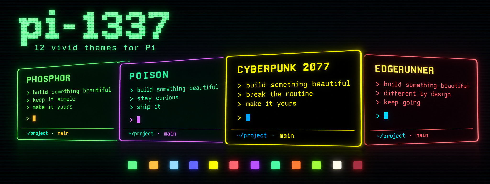

# pi-1337



**Twelve dark palettes and a framed terminal editor for [Pi](https://github.com/earendil-works/pi-mono).**
pi-1337 combines a set of phosphor-inspired themes with an extension that moves the editor and useful session status into a centered frame.

## What it adds

- A centered, rounded editor with a prompt marker, activity spinner, and status for the workspace, branch, session, context, estimated cost, model, agents, and persona.
- Twelve Pi themes that you can choose in `/settings`; Pi keeps the selected bundled theme across restarts.
- Compact tool transcript rows and theme-aware edit previews, with errors visible while collapsed.
- A reversible `/pi-1337` toggle and a clean-buffer copy shortcut (`alt+c` by default).

The extension changes presentation only. It leaves Pi's editor behavior, tool execution, prompts, and third-party custom tool renderers in place.
When pi-persona is installed, the frame can show its persona and agent count; the two packages work independently.

Edit previews use Pi's recorded diff, with separate changed spans emphasized inside
paired replacement lines. Collapsed previews show up to 16 rows; expand for the full
diff. Uneven change groups and large lines keep line colors without span emphasis.
Write previews show submitted file content.

## Palettes

| Theme | Character |
| --- | --- |
| `1337` | Yellow-green phosphor with amber UI accents. |
| `1337-amber` | Bright amber CRT with cream-gold accents. |
| `1337-ice` | Cool cyan-blue phosphor. |
| `1337-cyber` | Indigo surfaces, periwinkle text, and electric cyan. |
| `1337-cyberpunk-2077` | Neon yellow and cyan-blue on black. |
| `1337-cyberpunk-2077-edgerunner` | Muted red, yellow titles, and cyan on burgundy-black. |
| `1337-neon` | Synthwave violet, hot pink, and cyan. |
| `1337-poison` | Emerald green with orchid and cyan accents. |
| `1337-magma` | Molten coral-orange with crisp cyan accents. |
| `1337-fallout` | Yellow-lime Pip-Boy phosphor. |
| `1337-skynet` | Warm-white HUD with red accents on tinted black. |
| `1337-skynet-dark` | Red-on-near-black Skynet palette. |

All palettes share Pi's 51-token theme contract. See [palette design](docs/palette-design.md) for color references and contrast rules.

## Install

Install from the Pi package source:

```bash
pi install git:github.com/AeonDave/pi-theme-1337
```

From a local clone, use `pi install .` in the repository directory.

Requires Pi and Node.js 22.19 or later.

## Use

- Choose `1337` or any `1337-*` palette in `/settings`. The choice persists across restarts and `/reload`.
- Run `/pi-1337` to turn the editor redesign off or on.
- Press `alt+c` to copy the editor's logical text without frame characters or added row breaks.

`PI_1337_THEME` can explicitly pin a palette, for example `PI_1337_THEME=cyber`. Use `PI_1337_THEME=off` to keep Pi's current theme while using the framed editor.

## Essential settings

Settings can go in `~/.pi/agent/1337-theme/config.json`; `PI_CODING_AGENT_DIR` changes Pi's agent directory. Environment variables override matching file settings.

```json
{
  "copyKey": "alt+c",
  "polish": true
}
```

| Variable | Purpose |
| --- | --- |
| `PI_1337_THEME` | Select or pin a palette; `off` keeps the current Pi theme. |
| `PI_1337_COPY_KEY` | Change the clean-copy key; set it empty to disable the shortcut. |
| `PI_1337_POLISH=off` | Keep Pi's standard tool transcript renderers. |
| `PI_1337_BG` | Control optional terminal background tint (`on`, `off`, or a hex color). |
| `PI_1337_DISABLE` | Disable the extension. |

See [configuration](docs/configuration.md) for precedence, all options, theme sidecars, and optional avatars.

## Related docs

- [Theme motion profiles](docs/theme-motion.md)
- [Architecture and rendering](docs/architecture.md)

## Development

```bash
npm install --ignore-scripts
npm run typecheck
npm test
npm run test:parity
```

Development packages are pinned to Pi 1.4.0; wildcard peer dependencies do not promise compatibility with older hosts. Set `PI_TUI` to your installed `pi-tui/dist/index.js` for the parity sweep. Without it, the command uses a `../pi` checkout and skips if that checkout is absent.

## License

MIT
